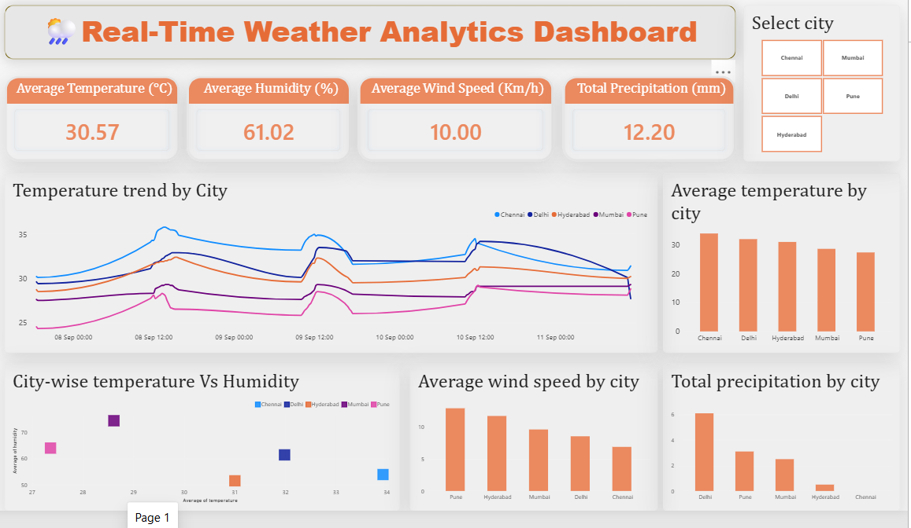
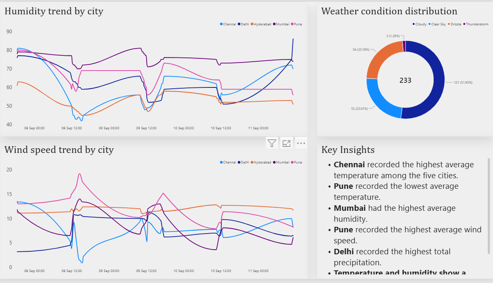

# 🌦️ Real-Time Weather Analytics Project

## 📌 Project Overview

This project is an end-to-end **real-time weather data analytics pipeline** built to collect, store, analyze, and visualize weather data for five major Indian cities.

Weather data is collected automatically every **15 minutes** using the **Open-Meteo API**, processed using Python, stored in PostgreSQL, analyzed using SQL, and visualized through an interactive Power BI dashboard.

The project demonstrates the complete workflow of a Data Analyst project — from **API data collection and database storage to SQL analysis and business-focused visualization**.

---

## 🎯 Project Objectives

* Collect real-time weather data from an external API.
* Automate data collection at 15-minute intervals.
* Collect weather information for multiple cities.
* Store structured data in PostgreSQL.
* Perform data cleaning and validation.
* Analyze weather trends using SQL.
* Apply SQL concepts such as CTEs, subqueries, window functions, and correlation analysis.
* Build an interactive Power BI dashboard.
* Generate meaningful insights from temperature, humidity, precipitation, wind speed, and weather conditions.

---

## 🏙️ Cities Covered

The project currently collects weather data for:

* Mumbai
* Pune
* Hyderabad
* Chennai
* Delhi

---

## 🛠️ Technologies Used

| Technology         | Purpose                                      |
| ------------------ | -------------------------------------------- |
| **Python**         | API data collection, cleaning and automation |
| **Requests**       | API communication                            |
| **Pandas**         | Data processing and transformation           |
| **PostgreSQL**     | Data storage and querying                    |
| **SQL**            | Data analysis and insight generation         |
| **Power BI**       | Interactive dashboard and visualization      |
| **Open-Meteo API** | Weather and geocoding data source            |

---

## 🔄 Project Architecture

```text
                    Open-Meteo API
                          │
                          ▼
                 Python Data Collector
                          │
              ┌───────────┴───────────┐
              │                       │
        Geocoding API           Weather API
              │                       │
              └───────────┬───────────┘
                          │
                          ▼
                  Data Cleaning
                          │
                          ▼
                    PostgreSQL
                          │
                          ▼
                    SQL Analysis
                          │
                          ▼
                     Power BI
                          │
                          ▼
                 Interactive Dashboard
```

---

## 📡 Data Collection

The Python pipeline uses two Open-Meteo APIs:

### 1. Geocoding API

The geocoding API converts a city name into its corresponding latitude and longitude.

```text
City Name
   ↓
Geocoding API
   ↓
Latitude + Longitude
```

### 2. Weather API

The coordinates are then passed to the weather API to retrieve current weather information.

The project collects:

* Temperature
* Relative Humidity
* Precipitation
* Wind Speed
* Cloud Cover
* Weather Code
* Timestamp
* City

---

## ⏱️ Automated Data Collection

The Python script runs continuously and collects weather information every **15 minutes**.

```text
Collect Data
     ↓
Clean & Validate
     ↓
Store in PostgreSQL
     ↓
Wait 15 Minutes
     ↓
Collect Again
```

The pipeline also includes retry handling for API failures and request timeouts.

---

## 🗄️ PostgreSQL Database

The collected weather data is stored in a PostgreSQL table:

```text
weather_data
```

Main fields include:

```text
id
timestamp
city
temperature
humidity
precipitation
wind_speed
cloud_cover
weather_code
```

A unique constraint on:

```text
(timestamp, city)
```

helps prevent duplicate weather records.

---

## 🧹 Data Cleaning & Validation

Before storing the data, the Python pipeline performs several checks:

* Removes leading/trailing spaces from city names.
* Removes records with missing timestamp or city.
* Removes duplicate `(timestamp, city)` combinations.
* Checks whether all expected cities were successfully collected.
* Handles API failures using retry logic.
* Uses request timeouts to prevent indefinite API calls.

---

# 📊 SQL Analysis

The project contains a dedicated SQL file documenting the analytical work performed during the project.

The SQL analysis includes:

### Data Validation

* Database and table inspection
* Record counts
* Duplicate checks
* Missing data checks
* Collection completeness
* Missing-city detection

### Weather Analysis

* Average temperature by city
* Average humidity by city
* Average wind speed
* Total precipitation
* Temperature range
* City-level comparisons

### Time-Series Analysis

* Temperature changes over time
* `LAG()` window function
* Largest temperature increase
* Largest temperature decrease
* Hourly temperature analysis
* Temperature variation by city

### Advanced SQL

The project also uses:

* CTEs
* Subqueries
* Window functions
* `ROW_NUMBER()`
* Aggregations
* `GROUP BY`
* `HAVING`
* `ORDER BY`
* Correlation analysis

### Example Analytical Question

One of the analytical questions answered using SQL was:

> **Which city has the second-highest average temperature?**

The analysis identified:

**Delhi — 31.98°C**

---

# 📈 Power BI Dashboard

The weather data stored in PostgreSQL was analyzed and visualized using Power BI to compare weather patterns across Mumbai, Pune, Hyderabad, Chennai, and Delhi.

## 📊 Dashboard Preview

### Dashboard — Page 1



### Dashboard — Page 2



## 📌 Key Dashboard Features

* **KPI Cards:** Average temperature, average humidity, and average wind speed.
* **Average Temperature by City:** Compare temperature levels across the five cities.
* **Temperature Trends Over Time:** Analyze temperature variations across collected timestamps.
* **Scatter Chart:** Explore relationships between weather variables.
* **City-Wise Comparison:** Compare weather metrics across different cities.
* **Interactive Visualizations:** Explore weather data and identify patterns through dashboard charts.

## 🎯 Dashboard Purpose

The dashboard provides a consolidated view of the collected weather data, helping users compare weather conditions, identify temperature variations, and explore relationships between weather parameters across the five cities.
---

# 🔎 Key Insights

Some of the observations identified during the analysis include:

* Chennai recorded the highest average temperature among the five cities.
* Pune recorded the lowest average temperature among the five cities.
* Delhi ranked second based on average temperature.
* Temperature and humidity showed a strong negative correlation across the analyzed cities.
* Weather conditions varied considerably between cities.
* The collected data can be used to monitor temperature, humidity, wind, and precipitation patterns over time.

---

## 🗂️ Project Files

| File                              | Description                                |
| --------------------------------- | ------------------------------------------ |
| `Weather_Collector.py`            | Python weather data collection script      |
| `test_postgresql.py`              | PostgreSQL connection and database testing |
| `Weather_Project_Queries.sql`     | SQL queries used for analysis              |
| `Real_Time_Weather_Analysis.pbix` | Power BI dashboard                         |
| `Weather_Data.csv`                | Exported weather dataset                   |
| `Weather_Project_Page1.png`       | Dashboard screenshot, Page 1               |
| `Weather_Project_Page2.png`       | Dashboard screenshot, Page 2               |


# 🚀 How the Project Works

### Step 1 — Run the Python Collector

The Python script connects to the Open-Meteo APIs and retrieves weather information for the five cities.

### Step 2 — Process the Data

Pandas is used to create and clean the weather records.

### Step 3 — Store the Data

The processed records are inserted into PostgreSQL.

### Step 4 — Analyze the Data

SQL queries are used to perform data validation, statistical analysis, time-series analysis, and city-level comparisons.

### Step 5 — Visualize the Results

The analyzed data is presented through an interactive Power BI dashboard.

---

# 💡 Skills Demonstrated

This project demonstrates practical experience in:

* Python
* API Integration
* Data Collection
* Data Cleaning
* Pandas
* PostgreSQL
* SQL
* CTEs
* Subqueries
* Window Functions
* Time-Series Analysis
* Correlation Analysis
* Power BI
* Data Visualization
* Dashboard Development
* Data Pipeline Automation

---

# 🎓 Project Learning

Through this project, I gained practical experience in building an end-to-end data analytics workflow rather than working only with static datasets.

The project helped me understand how to:

**Collect → Clean → Store → Analyze → Visualize → Generate Insights**

using a combination of REST API, Python, PostgreSQL, SQL, and Power BI.

## 👨‍💻 Author

**Aniket Jagtap**

GitHub: [Aniketjagtap45](https://github.com/Aniketjagtap45)
